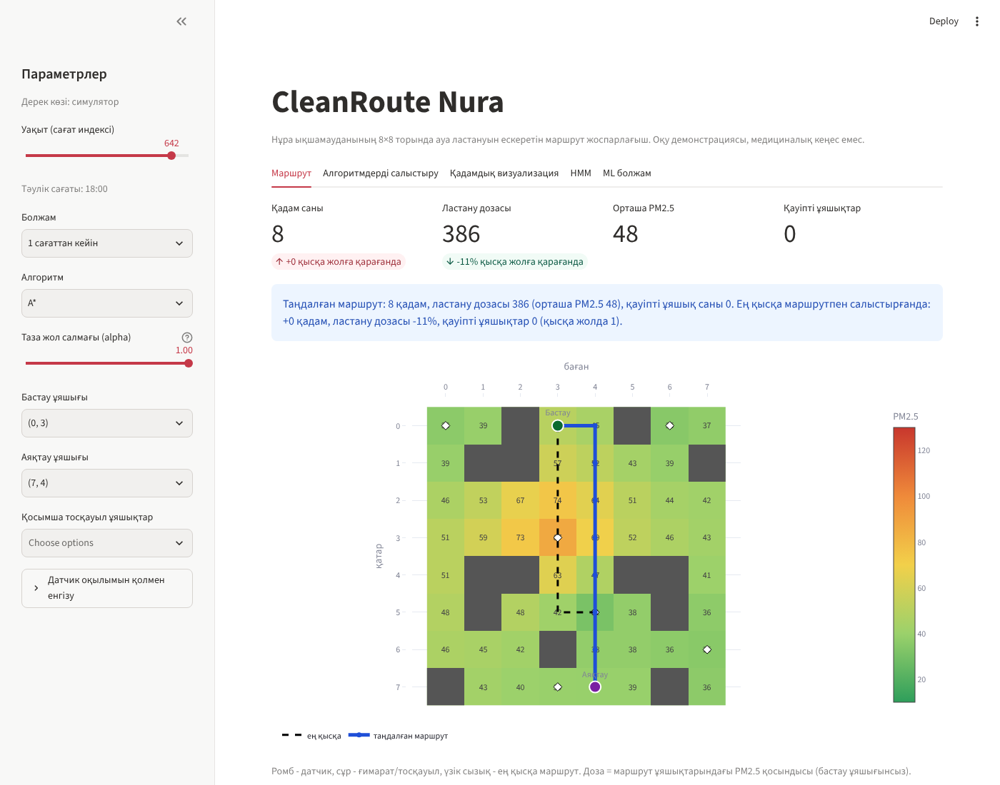
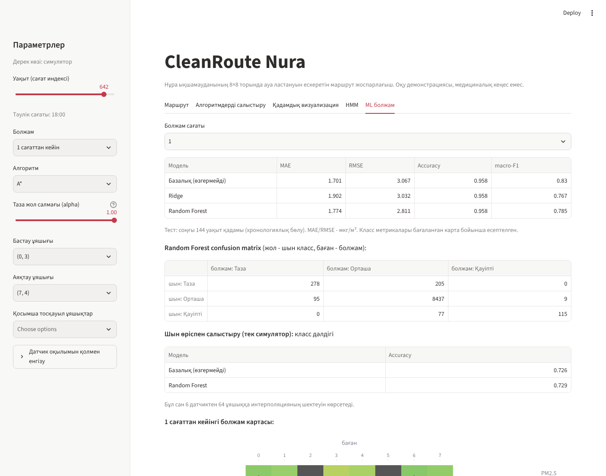

# CleanRoute Nura

Нұра ықшамауданының 8×8 торында ауа ластануын ескеретін маршрут жоспарлағыш.

> AI-powered route planner for Nura district (Astana): finds the cleanest walking route on an 8×8 air-pollution grid using A* search, HMM sensor filtering and ML forecasting.

QAIRU AI Fundamentals, Final Project 2026.

**Статус:** жұмыс істейтін прототип. Қазір ол **симуляцияланған деректермен** тексерілген. Нақты датчик деректері әлі қосылмаған, ұяшық орналасуы мен датчик орындары шартты (қараңыз: [Шектеулер](#шектеулер)).

## Мазмұны

1. [Жоба туралы](#жоба-туралы)
2. [Үш AI тақырыбы](#үш-ai-тақырыбы)
3. [Жүйе қалай жұмыс істейді](#жүйе-қалай-жұмыс-істейді)
4. [Орнату және іске қосу](#орнату-және-іске-қосу)
5. [Репозиторий құрылымы](#репозиторий-құрылымы)
6. [Тестілеу](#тестілеу)
7. [Деректер](#деректер)
8. [Нәтижелер](#нәтижелер)
9. [Шектеулер](#шектеулер)
10. [Команда және үлес](#команда-және-үлес)
11. [AI қолдану туралы мәлімдеме](#ai-қолдану-туралы-мәлімдеме)

## Жоба туралы

Қыста Астанада ауа сапасы нашарлайды, ал әдеттегі навигаторлар тек ең қысқа немесе ең жылдам жолды ұсынады. CleanRoute Nura пайдаланушыға тыныстайтын ауасы аз ластанған жаяу маршрутты табады.

Нұра ықшамауданы 8×8 торға (64 ұяшық) бөлінеді. Жүйе:

1. датчиктердің шулы оқылымдарынан ауаның нақты күйін бағалайды (HMM);
2. өткен деректер бойынша келесі 1–3 сағаттағы ластануды болжайды (ML);
3. болжам картасы бойынша қауіпті ұяшықтарды айналып өтетін маршрут салады (A*).

Бұл оқу жобасы: медициналық кеңес емес және клиникалық қолдануға арналмаған.



## Үш AI тақырыбы

Барлық алгоритмдер өз кодымызбен жазылған, дайын AI API қолданылмайды.

| Апта | Тақырып | Жобадағы іске асыру | Файл |
| --- | --- | --- | --- |
| 2 | Search, A*, эвристика | BFS, UCS және A* 8×8 торда, қадам құны ұяшық ластануына байланысты | `src/search.py` |
| 7 | Hidden Markov Models | Датчиктегі жасырын ауа күйін (Таза / Орташа / Қауіпті) бағалау: Forward және Viterbi | `src/hmm.py` |
| 8 | Classical ML | Келесі сағаттардағы PM2.5 өрісін болжау: Ridge және Random Forest, базалық модельмен салыстыру | `src/forecast.py` |
| 1 | Intelligent Agents (қосымша) | PEAS моделі: қабылдау, болжау, жоспарлау | `src/agent.py` |

## Жүйе қалай жұмыс істейді

```text
датчиктер -> HMM (қазір не) -> интерполяция (64 ұяшық) -> ML (1-3 сағаттан кейін не) -> A* (маршрут)
```

1. **Деректер.** `data/readings.csv` болса, содан оқылады, болмаса `src/simulator.py` деректер жасайды.
2. **HMM.** Әр датчиктің шулы оқылымы жасырын күйге (Таза / Орташа / Қауіпті) айналады, ал күй сенімінен күтілетін PM2.5 есептеледі. Параметрлер (бастапқы, ауысу, эмиссия) санау арқылы бағаланады.
3. **Интерполяция.** 6 датчиктен 64 ұяшыққа қашықтыққа кері пропорционал салмақтау (IDW) арқылы толық карта жасалады.
4. **ML.** Модель әр ұяшық үшін h сағаттан кейінгі PM2.5-ті болжайды. Белгілер: ұяшықтың өткен екі сағаттағы мәні, төрт көршінің мәні, жел (бағыт, жылдамдық), тәулік сағаты, ұяшық түрі мен орны. Оқыту/тест бөлінісі хронологиялық (алғашқы 80% / соңғы 20%).
5. **Құн картасы.** Ұяшыққа өтудің құны:

```latex
c(v) = (1 - alpha) + alpha * pm(v) / pm_ref
```

`alpha` пайдаланушы таңдайды (0 = ең қысқа жол, 1 = ластануды барынша азайту), `pm_ref` картаның орташа мәні. Сондықтан `alpha = 1` кезінде жол құны маршруттағы ластану дозасына пропорционал.

6. **Іздеу.** A* эвристикасы `h(n) = Manhattan(n, goal) * c_min`, мұндағы `c_min` өтуге болатын ұяшықтардағы ең кіші қадам құны. Әр қадам құны `c_min`-нен кем емес, сондықтан эвристика допустимді және консистентті, A* оңтайлы жол табады (тестпен расталған).

Ғимараттар және қолмен жабылған ұяшықтар тосқауыл. Ластанған ұяшық жабылмайды, тек «қымбат» болады.

## Орнату және іске қосу

Талап: Python 3.10 немесе жаңарақ. Тексерілген орта: Python 3.13, streamlit 1.67, plotly 7.1, scikit-learn 1.9.

```bash
git clone https://github.com/<username>/cleanroute-nura.git
cd cleanroute-nura

python -m venv .venv
source .venv/bin/activate        # Windows: .venv\Scripts\activate

pip install -r requirements.txt
streamlit run app.py
```

Қосымша `http://localhost:8501` мекенжайында ашылады. Интерфейсте: бастау/аяқтау ұяшығы, алгоритм (BFS/UCS/A*), `alpha`, болжам сағаты, қосымша тосқауылдар, қолмен PM2.5 енгізу; қойындылар: маршрут, алгоритмдерді салыстыру, A* қадамдық визуализациясы, HMM, ML болжам.

Метрикаларды қайта есептеу: `python evaluate.py`.

Бұл жобада құпия API кілті қажет емес.

## Репозиторий құрылымы

```text
cleanroute-nura/
├── app.py                 # Streamlit интерфейсі
├── config.py              # шектер, тор өлшемі, датчик орындары, әдепкі тор
├── evaluate.py            # барлық метрикаларды қайта есептеу
├── data/grid.json         # 8x8 тор (0 жол, 1 ғимарат, 2 саябақ, 3 магистраль) және датчиктер
├── src/
│   ├── agent.py           # 1-апта: агент, жоспарлау, түсіндірме
│   ├── search.py          # 2-апта: BFS, UCS, A*
│   ├── hmm.py             # 7-апта: Forward, Viterbi
│   ├── forecast.py        # 8-апта: ML болжам
│   ├── pipeline.py        # HMM -> IDW интерполяциясы
│   └── simulator.py       # синтетикалық деректер, CSV оқу/жазу
├── tests/                 # pytest
├── docs/                  # скриншоттар
├── requirements.txt
└── README.md
```

## Тестілеу

```bash
pytest -v
```

32 тест. Негізгілері:

| Тақырып | Не тексеріледі |
| --- | --- |
| A* | 100 кездейсоқ торда A* құны UCS құнына тең, ашылған түйіндері артық емес; BFS ең аз қадам береді; `alpha = 0` кезінде жол ең қысқа; таза жол лас қатарды айналып өтеді; жол жоқ болса бос нәтиже; тосқауылдан өтпейді |
| HMM | Forward сенімдерінің қосындысы 1; Viterbi қысқа тізбекте толық іріктеумен (brute force) сәйкес; тест бөлігінде HMM шекпен тікелей бөлуден дәлірек |
| ML | RMSE бойынша Random Forest базалық модельден жақсы; болжам болашақ деректерге тәуелді емес; тарих жеткіліксіз болса қате |
| Енгізу | Бірдей/тосқауыл/тордан тыс ұяшық, жарамсыз `alpha`, белгісіз алгоритм, теріс/өте үлкен/сан емес PM2.5, бұзылған CSV |
| Тізбек | `readings.csv` режимі: сақтау → оқу → агент → маршрут |

Тесттердің шынымен қате ұстайтыны мутациялық тексерумен расталды: эвристиканы әдейі бұзғанда A* тесттері, Viterbi кері жолын бұзғанда HMM тесттері құлады.

## Деректер

- **Қазіргі режим:** `src/simulator.py` синтетикалық деректер жасайды (30 күн, 6 датчик). Модель PM2.5 өрісін желмен жылжытады, көршілерге таратады, ішінара сөндіреді және көздермен (магистраль, ғимараттар) толықтырады. Артықшылығы: шын жасырын күй белгілі, сондықтан HMM мен ML дәлдігін объективті өлшеуге болады.
- **Нақты деректер:** `data/readings.csv` жасаңыз (`python -m src.simulator` үлгі файл жазады). Бағандар: `hour, wind_dr, wind_dc, wind_speed, s0..s5`. Файл бар болса, қосымша соны оқиды. Бұл режимде шын өріс белгісіз, сондықтан HMM жалған белгілермен (тегістелген оқылымдар) оқытылады, ал «шын өріспен салыстыру» көрсетілмейді.
- **Ауа райы / ауа сапасы көздері:** Open-Meteo, OpenAQ. Қазіргі код оларды автоматты түрде жүктемейді, оқылымдарды CSV-ге қолмен салу керек.

> Нұра аймағында нақты датчиктердің бар-жоғын тексеріп, осы бөлімді толықтырыңыз.

## Нәтижелер

Барлық сандар `python evaluate.py` арқылы алынған (seed = 42, 720 сағат: 576 оқыту, 144 тест). Бір симуляция, бір тест бөлігі (6 күн), сондықтан сандарды шамамен ғана түсіну керек.

**HMM** (6 датчиктің орташасы, шын күйге қарағанда дәлдік):

| Әдіс | Accuracy |
| --- | --- |
| Шулы оқылымды шекпен бөлу | 0.670 |
| HMM Forward | 0.765 |
| HMM Viterbi | 0.801 |

**ML болжам** (RMSE, мкг/м³; төмен - жақсы):

| Болжам | Базалық (өзгермейді) | Ridge | Random Forest |
| --- | --- | --- | --- |
| 1 сағат | 3.07 | 3.03 | 2.81 |
| 2 сағат | 4.30 | 4.13 | 3.39 |
| 3 сағат | 5.07 | 4.78 | 3.87 |

Random Forest RMSE бойынша базалық модельден жақсы, ал уақыт горизонты ұзарған сайын айырмашылық артады. Бірақ **класс бойынша** (Таза/Орташа/Қауіпті) Accuracy бірдей (шамамен 0.95), ал macro-F1 базалық модельден төмен (мысалы 1 сағатта 0.785 vs 0.830), өйткені «Қауіпті» класс сирек. Бағаланған картаны шын өріспен салыстырғанда класс дәлдігі небәрі шамамен 0.73: негізгі шектеу 6 датчиктен интерполяция.

**Маршрут** (177 кездейсоқ жұп, 1 сағаттық болжам, `alpha = 1` ең қысқа жолмен салыстырғанда):

| Көрсеткіш | Мән |
| --- | --- |
| Ластану дозасының орташа өзгерісі | −2.8% |
| Медиана | −0.3% |
| Ең жақсы жағдай | −17.8% |
| Қосымша қадам (орташа / ең көбі) | 0.08 / 2 |
| Таза маршрут ең қысқадан өзгеше | 55% жағдайда |

Яғни орта есеппен пайда шамалы, ал кейбір жұптарда айтарлықтай (демо әдепкісі: (0,3) → (7,4), 18:00, шамамен −11%). Себебі: симуляцияланған өріс тегіс, торда тек бір магистраль бар, көп маршруттар тосқауылдармен мәжбүрленген.

**A* vs UCS.** Екеуі де бірдей оңтайлы құн береді. `alpha = 0` кезінде (қарапайым жағдай) A* түйінді азырақ ашады (мысалы 41 vs 50). `alpha = 1` кезінде 100 кездейсоқ картада A* UCS-тің түйіндерінің шамамен 97%-ын ашады: `c_min` кіші болғандықтан эвристика әлсіз, ал 8×8 тор өзі де кішкентай.



## Шектеулер

- Бұл оқу демонстрациясы, медициналық кеңес емес.
- Нәтижелер симуляцияланған деректерде алынған. Нақты деректерде нәтиже басқа болуы мүмкін.
- Тор орналасуы (ғимараттар, магистраль) мен 6 датчиктің орны шартты. Оларды нақты карта бойынша (`data/grid.json`, `config.py`) ауыстыру керек.
- 8×8 тор ластануды шамамен бағалайды, жеке тыныс алу дозасын дәл өлшемейді. 6 датчиктен интерполяция жергілікті айырмашылықтарды тегістейді.
- ML физикалық дисперсия моделі емес, статистикалық болжам. «Қауіпті» класс сирек болғандықтан, класс метрикалары әлсіз.
- Нақты режимде HMM жалған белгілермен оқытылады (шын күй белгісіз).
- Қозғалыс 4 бағытта (жоғары, төмен, солға, оңға).

## Команда және үлес

| Қатысушы | Жауапкершілік |
| --- | --- |
| [Аты-жөні 1] | Архитектура, агент (1-апта), `grid.json`, симулятор, README |
| [Аты-жөні 2] | BFS, UCS, A* (2-апта), құн картасы, іздеу тесттері |
| [Аты-жөні 3] | HMM (7-апта), ML болжам (8-апта), метрикалар |
| [Аты-жөні 4] | Интерфейс, визуализация, қадамдық анимация, интеграция |

## AI қолдану туралы мәлімдеме

[Жобада AI құралдары (мысалы, Claude) қай жерде және қалай қолданылғанын осында жазыңыз. Бастапқы код құрылымы мен тесттер AI көмегімен жасалса, соны ашық көрсетіңіз және әр алгоритмді өзіңіз түсіндіре алатыныңызға көз жеткізіңіз.]

## Лицензия

[Лицензияны таңдаңыз, мысалы MIT.]
